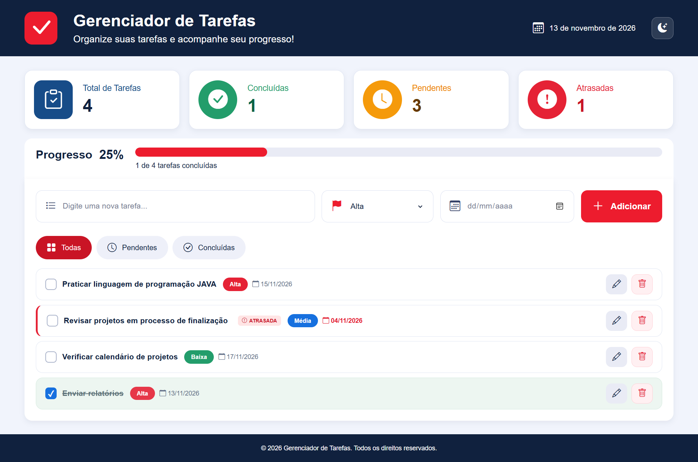
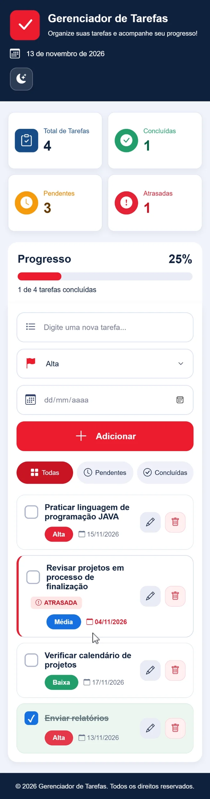

# Gerenciador de Tarefas

Um projeto simples de gerenciamento de tarefas desenvolvido para praticar os fundamentos de desenvolvimento web com HTML, CSS e JavaScript.

## Sobre o projeto

O Gerenciador de Tarefas permite cadastrar atividades, organizar prioridades, definir prazos e acompanhar o progresso das tarefas concluídas.

Os dados são armazenados no navegador utilizando LocalStorage, permitindo que as tarefas continuem salvas mesmo após atualizar ou fechar a página.

## Funcionalidades

- Adicionar novas tarefas.
- Definir prioridade: alta, média ou baixa.
- Definir prazo para cada tarefa.
- Editar tarefas cadastradas.
- Excluir tarefas.
- Marcar tarefas como concluídas ou pendentes.
- Filtrar tarefas por status.
- Visualizar o total de tarefas cadastradas.
- Acompanhar tarefas concluídas, pendentes e atrasadas.
- Visualizar o progresso em uma barra percentual.
- Salvar os dados automaticamente no LocalStorage.

## Tecnologias utilizadas

- HTML5
- CSS3
- JavaScript
- LocalStorage
- Bootstrap Icons

## Como executar o projeto

1. Baixe ou clone este repositório.
2. Abra a pasta do projeto.
3. Execute o arquivo `index.html` no navegador.

Não é necessário instalar dependências ou configurar um servidor.

## Objetivo

Este projeto foi desenvolvido como exercício prático de aprendizado, com o objetivo de aplicar conceitos de estruturação HTML, estilização CSS, manipulação do DOM, eventos JavaScript e armazenamento local de dados.

## Autor

Desenvolvido por Italo Alves.

